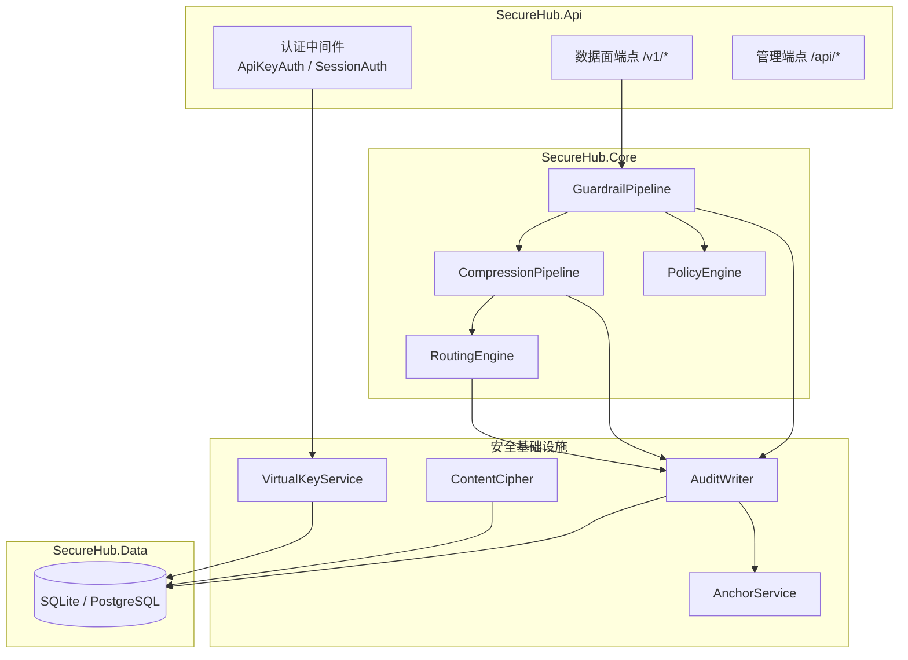

# Secure Hub 安全设计

> 对应 PRD：§7 安全治理、§6.5 输入压缩、§11 内建助手、§5.5 BYOK、§7.8 个人主体
> 版本：v0.2（与 PRD v0.5 对齐）
> 读者：实现者。本文档给到**表结构、算法、伪代码、测试用例**，不再重复"为什么"。

---

## 1. 范围与不变量

本文覆盖：身份与授权、护栏、策略引擎、内容存储、审计链、压缩与审计的交互。

**五条不变量**（任何实现改动都不得破坏）：

| #   | 不变量                                              | 破坏方式举例                                            |
| --- | --------------------------------------------------- | ------------------------------------------------------- |
| I1  | 上游凭据永不出现在任何响应、日志、审计中            | 错误信息里拼了 `upstream.RequestUri`（含 key 查询参数） |
| I2  | 审计表只允许 INSERT，且 `hash` 链可校验             | 为了改误报标记去 UPDATE 原行                            |
| I3  | 内容表密文与 `requestId + direction + variant` 绑定 | 用同一个 nonce 加密多条，或 AAD 漏字段                  |
| I4  | 护栏在压缩之前执行                                  | 为了省算力把压缩提到护栏前                              |
| I5  | **BYOK 凭据与密钥只能被属主使用**                   | 路由时只校验供应商 id，没校验 `OwnerUserId`             |

---

## 2. 模块划分



| 模块                  | 职责                              | 不得做的事                 |
| --------------------- | --------------------------------- | -------------------------- |
| `ApiKeyAuth`          | 解析虚拟密钥、校验状态与约束      | 不得查上游凭据表           |
| `PolicyEngine`        | 评估策略、产出可解释决策          | 不得直接读写正文           |
| `GuardrailPipeline`   | 跑检测器、合成动作、改写文本      | 不得执行外部脚本           |
| `CompressionPipeline` | 文本级去冗余、算前后 token        | 不得改变语义（改写）       |
| `AuditWriter`         | 分配 sequence、算链哈希、批量落库 | 不得提供 Update/Delete API |
| `ContentCipher`       | AES-GCM 加解密、DEK 轮换          | 不得把明文传给日志         |
| `AnchorService`       | 周期生成锚点                      | 不得与审计同表             |

---

## 3. 数据模型

> EF Core 生成；以下为逻辑结构。所有主键 `Guid`（应用侧生成），时间 `DateTimeOffset`。

### 3.1 身份与授权

```sql
-- 用户（控制台）
CREATE TABLE User (
  Id            UUID PRIMARY KEY,
  UserName      TEXT NOT NULL,          -- 唯一，大小写不敏感
  PasswordHash  TEXT NOT NULL,          -- pbkdf2$sha256$210000$<saltB64>$<hashB64>
  TotpSecret    TEXT NULL,              -- 加密存储（T15：可选）
  TeamId        UUID NULL,
  Roles         TEXT NOT NULL,          -- JSON 数组，如 ["Auditor"]
  IsActive      BOOLEAN NOT NULL,
  CreatedAt     TIMESTAMPTZ NOT NULL
);

-- 虚拟密钥（应用/项目只是标签，不是独立实体）
CREATE TABLE VirtualKey (
  Id            UUID PRIMARY KEY,
  KeyId         TEXT NOT NULL,          -- 8 hex，唯一，用于索引
  SecretHash    BYTEA NOT NULL,         -- SHA-256(secret)，32B
  Prefix        TEXT NOT NULL,          -- 前 12 字符（展示用）
  DisplayName   TEXT NOT NULL,
  OwnerType     TEXT NOT NULL,          -- org | user
  OwnerId       UUID NOT NULL,          -- User.Id；企业密钥为全零
  AppName       TEXT NULL,              -- 项目/软件标签，用于审计与用量
  TeamId        UUID NULL,              -- 企业密钥的团队归属
  Scopes        TEXT NOT NULL,          -- JSON 数组
  Constraints   TEXT NULL,              -- JSON：allowedModels / allowedIpCidrs / rpm...
  Status        TEXT NOT NULL,          -- active | revoked
  ExpiresAt     TIMESTAMPTZ NULL,
  RotatedFromId UUID NULL,              -- 轮换来源
  CreatedAt     TIMESTAMPTZ NOT NULL,
  RevokedAt     TIMESTAMPTZ NULL
);
CREATE UNIQUE INDEX UX_VirtualKey_KeyId ON VirtualKey(KeyId);
CREATE INDEX IX_VirtualKey_Owner ON VirtualKey(OwnerType, OwnerId);
CREATE INDEX IX_VirtualKey_AppName ON VirtualKey(AppName);

-- 供应商（企业级 / 个人级）
CREATE TABLE Provider (
  Id           UUID PRIMARY KEY,
  Scope        TEXT NOT NULL,           -- org | user
  OwnerUserId  UUID NULL,               -- Scope=user 时必填
  ProviderKey  TEXT NOT NULL,           -- models.dev provider id
  BaseUrl      TEXT NOT NULL,
  DisplayName  TEXT NOT NULL,
  Enabled      BOOLEAN NOT NULL,
  HealthStatus TEXT NOT NULL,           -- healthy | unhealthy | unknown
  CreatedAt    TIMESTAMPTZ NOT NULL
);
CREATE INDEX IX_Provider_Scope ON Provider(Scope, OwnerUserId);

-- 供应商凭据（企业或个人的 Key）
CREATE TABLE ProviderCredential (
  Id           UUID PRIMARY KEY,
  ProviderId   UUID NOT NULL,
  OwnerUserId  UUID NULL,               -- 个人凭据必填
  CipherText   BYTEA NOT NULL,          -- DataProtection 加密
  KeyHint      TEXT NOT NULL,           -- 末 4 位，便于用户辨认
  CreatedAt    TIMESTAMPTZ NOT NULL,
  RetiredAt    TIMESTAMPTZ NULL
);
CREATE INDEX IX_Credential_Owner ON ProviderCredential(OwnerUserId);
```

-- 企业分配（T20）
CREATE TABLE Entitlement (
  Id          UUID PRIMARY KEY,
  SubjectType TEXT NOT NULL,        -- all | team | user
  SubjectId   UUID NULL,            -- all 时为空
  ProviderId  UUID NOT NULL,
  Models      TEXT NULL,            -- JSON 数组；空 = 该供应商全部
  TokenQuota  BIGINT NULL,
  CostQuota   NUMERIC(18,6) NULL,
  ExpiresAt   TIMESTAMPTZ NULL,
  CreatedBy   UUID NOT NULL,
  CreatedAt   TIMESTAMPTZ NOT NULL
);
CREATE INDEX IX_Entitlement_Subject ON Entitlement(SubjectType, SubjectId);

-- 负载均衡组（T22）
CREATE TABLE ModelGroup (
  Id           UUID PRIMARY KEY,
  Name         TEXT NOT NULL,          -- 如 gpt-4o（自动）或 fast（显式）
  IsAuto       BOOLEAN NOT NULL,       -- 同名自动成组
  Enabled      BOOLEAN NOT NULL,
  AllowCrossScope BOOLEAN NOT NULL DEFAULT FALSE,
  Strategy     TEXT NOT NULL,          -- priority-weighted | cost | latency
  CreatedAt    TIMESTAMPTZ NOT NULL
);
CREATE UNIQUE INDEX UX_ModelGroup_Name ON ModelGroup(Name);

CREATE TABLE ModelGroupMember (
  Id            UUID PRIMARY KEY,
  GroupId       UUID NOT NULL,
  Scope         TEXT NOT NULL,          -- org | user
  ProviderId    UUID NOT NULL,
  UpstreamModel TEXT NOT NULL,
  Priority      INT  NOT NULL,
  Weight        INT  NOT NULL,
  Enabled       BOOLEAN NOT NULL,
  State         TEXT NOT NULL           -- healthy | degraded | disabled
);
CREATE INDEX IX_GroupMember_Group ON ModelGroupMember(GroupId, Priority);
```

> **解析顺序**：`user` > `team` > `all`。同一模型命中多条时取最具体那条的额度。授权解析在路由前完成，结果写入审计 `detail.entitlementId`，便于回答"为什么他能用这个模型"。

> **I5 的落地**：`ProviderCredential.OwnerUserId` 与 `Provider.OwnerUserId` 必须一致，且请求的密钥属主 = 用户本人。路由前做一次断言，不满足直接 `key_owner_mismatch`。

### 3.2 策略与命中

```sql
CREATE TABLE SecurityPolicy (
  Id          UUID PRIMARY KEY,
  PolicyKey   TEXT NOT NULL,            -- 业务 ID，如 pol-pii-block-prod
  ActiveVersion INT NULL,
  Enabled     BOOLEAN NOT NULL,
  CreatedAt   TIMESTAMPTZ NOT NULL
);

CREATE TABLE SecurityPolicyVersion (
  Id          UUID PRIMARY KEY,
  PolicyId    UUID NOT NULL,
  Version     INT  NOT NULL,
  Priority    INT  NOT NULL,
  ScopeJson   TEXT NOT NULL,            -- teams/apps/models/environments
  WhenJson    TEXT NOT NULL,            -- 条件树（见 §7）
  ThenJson    TEXT NOT NULL,            -- action / reason / alert
  OnError     TEXT NOT NULL,            -- block | allow
  RolloutJson TEXT NULL,                -- { percent: 5 }
  Diff        TEXT NULL,                -- 与上一版差异
  ChangeReason TEXT NOT NULL,           -- 必填
  CreatedBy   UUID NOT NULL,
  CreatedAt   TIMESTAMPTZ NOT NULL
);
CREATE UNIQUE INDEX UX_Policy_Version ON SecurityPolicyVersion(PolicyId, Version);
```

> **策略编译**：`WhenJson` 在启动/变更时编译为 `Func<EvaluationContext, bool>` 树，拒绝任何字符串形式表达式（见 §7.3）。

### 3.3 审计

```sql
CREATE TABLE AuditEvent (
  EventId        UUID PRIMARY KEY,
  OccurredAt     TIMESTAMPTZ NOT NULL,
  Sequence       BIGINT NOT NULL,       -- 单机单调，唯一
  EventType      TEXT NOT NULL,
  Severity       TEXT NOT NULL,         -- info | warning | critical
  ActorType      TEXT NOT NULL,         -- virtualKey | user | system | assistant
  ActorId        TEXT NOT NULL,
  ActorLabel     TEXT NOT NULL,
  AppName        TEXT NULL,             -- 项目/软件标签；旧事件回退 ActorLabel
  AppId          UUID NULL,             -- 仅保留用于历史链校验，新事件不写
  TeamId         UUID NULL,
  RequestId      TEXT NULL,
  ModelAlias     TEXT NULL,
  ModelGroupId   UUID NULL,             -- 负载均衡组（命中时必填）
  ModelMemberId  UUID NULL,             -- 实际命中的成员：真实调用归属的依据
  ProviderId     TEXT NULL,
  UpstreamModel  TEXT NULL,
  Action         TEXT NOT NULL,
  PolicyId       TEXT NULL,
  PolicyVersion  INT NULL,
  RuleId         TEXT NULL,
  ReasonCode     TEXT NOT NULL,
  Detail         TEXT NULL,             -- JSON，禁止含正文
  InputTokens    INT NULL,
  InputTokensOriginal INT NULL,         -- 压缩前（§6.5.5）
  OutputTokens   INT NULL,
  CostUsd        NUMERIC(18,6) NULL,
  IpAddress      TEXT NULL,
  UserAgent      TEXT NULL,
  ContentHash    TEXT NULL,
  ContentMissing BOOLEAN NOT NULL DEFAULT FALSE,
  PrevHash       TEXT NOT NULL,
  Hash           TEXT NOT NULL
);
CREATE UNIQUE INDEX UX_Audit_Sequence ON AuditEvent(Sequence);
CREATE INDEX IX_Audit_OccurredAt ON AuditEvent(OccurredAt);
CREATE INDEX IX_Audit_App_Time ON AuditEvent(AppName, OccurredAt);
CREATE INDEX IX_Audit_LegacyApp_Time ON AuditEvent(AppId, OccurredAt);
CREATE INDEX IX_Audit_RequestId ON AuditEvent(RequestId);
CREATE INDEX IX_Audit_PolicyRule ON AuditEvent(PolicyId, RuleId);
```

**只插不改的落地方式**：

| Provider   | 做法                                                                                                                    |
| ---------- | ----------------------------------------------------------------------------------------------------------------------- |
| PostgreSQL | 审计表由独立 role 拥有；应用 role 仅 `INSERT` + `SELECT`，显式 `REVOKE UPDATE, DELETE`                                  |
| SQLite     | 建 `BEFORE UPDATE` / `BEFORE DELETE` 触发器 `RAISE(ABORT)`；仅迁移脚本用 `PRAGMA recursive_triggers` 绕过（迁移需停机） |

```sql
-- 锚点（与审计表物理分离）
CREATE TABLE AuditAnchor (
  Id         UUID PRIMARY KEY,
  Sequence   BIGINT NOT NULL,
  Hash       TEXT NOT NULL,
  CreatedAt  TIMESTAMPTZ NOT NULL
);

-- 误报申诉（独立表，不回改审计行）
CREATE TABLE AuditEventDispute (
  Id           UUID PRIMARY KEY,
  EventId      UUID NOT NULL,
  DisputeType  TEXT NOT NULL,           -- false_positive | wrong_reason
  Note         TEXT NULL,
  CreatedBy    UUID NOT NULL,
  CreatedAt    TIMESTAMPTZ NOT NULL,
  ResolvedAt   TIMESTAMPTZ NULL
);
```

### 3.4 内容与密钥

```sql
CREATE TABLE ContentBlob (
  ContentId    UUID PRIMARY KEY,
  RequestId    TEXT NOT NULL,
  Direction    TEXT NOT NULL,           -- request | response
  Variant      TEXT NOT NULL,           -- raw | redacted | compressed
  AppName      TEXT NULL,               -- 项目/软件标签
  Ciphertext   BYTEA NOT NULL,
  DekId        TEXT NOT NULL,
  ContentHash  TEXT NOT NULL,           -- SHA-256(plaintext)，hex
  SizeBytes    INT  NOT NULL,
  Truncated    BOOLEAN NOT NULL,
  CreatedAt    TIMESTAMPTZ NOT NULL,
  ExpiresAt    TIMESTAMPTZ NOT NULL
);
CREATE UNIQUE INDEX UX_Content ON ContentBlob(RequestId, Direction, Variant);
CREATE INDEX IX_Content_App_Expire ON ContentBlob(AppName, ExpiresAt);

CREATE TABLE ContentDek (
  DekId       TEXT PRIMARY KEY,         -- 如 k2026-11
  WrappedDek  BYTEA NOT NULL,           -- KEK 包裹后的 DEK
  Algorithm   TEXT NOT NULL,            -- AES-256-GCM
  CreatedAt   TIMESTAMPTZ NOT NULL,
  RetiredAt   TIMESTAMPTZ NULL
);
```

---

## 4. 密钥与凭据

### 4.1 虚拟密钥生命周期

```mermaid
sequenceDiagram
    participant Admin as 管理员
    participant API as 管理 API
    participant KS as VirtualKeyService
    participant DB as DB

    Admin->>API: POST /api/keys {appId, scopes, constraints}
    API->>KS: CreateAsync
    KS->>KS: keyId = 8 hex; secret = random(32B) → base62
    KS->>KS: hash = SHA256(secret)
    KS->>DB: INSERT VirtualKey(keyId, hash, prefix)
    KS-->>API: 返回一次性明文 sk-sh-live-{keyId}-{secret}
    API-->>Admin: 仅此一次可见

    Note over Admin,DB: —— 轮换 ——
    Admin->>API: POST /api/keys/{id}/rotate {overlapHours: 24}
    API->>KS: 新建密钥，RotatedFromId = 旧 id
    KS->>DB: 旧密钥 ExpiresAt = now + overlap
```

**校验算法**（顺序即成本从低到高）：

```csharp
public async ValueTask<AuthResult> AuthenticateAsync(string rawKey, IPAddress? ip, CancellationToken ct)
{
    // 1. 语法
    if (!KeyFormat.TryParse(rawKey, out var keyId, out var secret, out var env))
        return AuthResult.Fail("invalid_api_key");           // 统一错误，不区分原因

    // 2. 存在性（走 keyId 唯一索引）
    var key = await _db.VirtualKeys.AsNoTracking()
        .FirstOrDefaultAsync(k => k.KeyId == keyId, ct);
    if (key is null) return AuthResult.Fail("invalid_api_key");

    // 3. 哈希（常量时间）
    var hash = SHA256.HashData(Encoding.ASCII.GetBytes(secret));
    if (!CryptographicOperations.FixedTimeEquals(hash, key.SecretHash))
        return AuthResult.Fail("invalid_api_key");

    // 4. 状态
    if (key.Status == "revoked" || key.RevokedAt is not null) return AuthResult.Fail("invalid_api_key");
    if (key.ExpiresAt is { } exp && exp <= _clock.UtcNow)      return AuthResult.Fail("invalid_api_key");

    // 5. 环境前缀（live 密钥不能打测试端点）
    if (env != _options.Environment)                          return AuthResult.Fail("invalid_api_key");

    // 6. IP 约束
    if (!Constraints.AllowsIp(key, ip))                       return AuthResult.Fail("invalid_api_key");

    return AuthResult.Ok(key);
}
```

> 所有失败路径都返回同一个 `401`（`reason` 只在审计里区分），防止枚举。审计写 `auth_failed`，`detail` 含 `stage`（syntax/existence/hash/status/env/ip）。

**缓存**：`KeyId → (SecretHash, Status, Constraints, Version)` 进程内缓存，TTL 60s；吊销时通过 `ConcurrentDictionary` 版本号立即失效（≤5s 全量生效）。

### 4.2 上游凭据

```csharp
// 存储：DataProtection 加密后 base64 入列
var protectedBytes = _dataProtection.Protect(Encoding.UTF8.GetBytes(apiKey), purpose: "provider-credential");
```

- 密钥环目录：`{DataDirectory}/keys`，`PersistKeysToFileSystem` 显式配置；**不得**用默认临时目录。
- 读取只发生在 `ProviderClientFactory` 内部，`ProviderCredential` 实体**不暴露**解密方法给上层。
- 观测：每次解密计数 +1；异常解密的速率升高视为攻击信号（告警）。

### 4.3 内容 DEK

```csharp
// 封装
static byte[] Seal(byte[] plaintext, ReadOnlySpan<byte> kek, out string dekId, out byte[] nonce)
{
    dekId = CurrentDekId();                        // yyyy-MM
    var dek    = UnwrapDek(dekId, kek);            // AES-KW 或 GCM 包裹
    nonce      = RandomNumberGenerator.GetBytes(12);
    var tag    = new byte[16];
    var cipher = new byte[plaintext.Length];
    using var gcm = new AesGcm(dek, tagSizeInBytes: 16);
    gcm.Encrypt(nonce, plaintext, cipher, tag, associatedData: BuildAad(requestId, direction, variant));
    return cipher;                                  // 密文与 tag 分列存储
}
```

**AAD 规范**（必须逐字一致）：

```text
UTF8($"{requestId}|{direction}|{variant}")
```

- `requestId` 为字符串原样（大小写敏感），`direction` / `variant` 为小写枚举。
- 缺任一字段都会让密文可跨请求搬移——这是最容易犯的错。
- **密钥轮换**：新数据用新 DEK；旧 DEK 保留在 `ContentDek` 中，`RetiredAt` 标记但仍可解。**DEK 丢失 = 对应正文永久不可读**，因此 KEK 备份是部署必检项。

---

## 5. 请求管道

### 5.1 顺序（不可调换）

```text
1. 认证（ApiKeyAuth）
2. 配额与限流（读缓存，不查库）
3. 载荷校验（大小 / max_tokens / JSON 结构）
4. 保存 raw 内容（异步）
5. 入向护栏（读原文）
6. 保存 redacted 内容（异步，仅当被改写）
7. **模型 ID 解析 + 授权解析**（全限定→ 单一供应商；裸 ID → 唯一候选或 §6.6 组选择；同时确定额度与 `billingOwner`）
8. 策略评估（安全 + 路由共用上下文）
9. 压缩（§6.5）
10. 保存 compressed 内容（异步）
11. 路由 → 上游
12. 出向护栏（流式逐块）
13. 计量与审计
```

**为什么 raw 在护栏前保存**：护栏可能拦截，而**被拦截的请求恰恰是审计价值最高的**。如果先护栏再保存，拦截事件就没有原文可用。

### 5.2 决策与错误码

| 情况                | HTTP | 统一错误码                | 说明                              |
| ------------------- | ---- | ------------------------- | --------------------------------- |
| 密钥无效/过期/吊销  | 401  | `invalid_api_key`         | 原因不外泄                        |
| scope 不足          | 403  | `insufficient_scope`      | 需要登录态才可区分                |
| 被护栏拦截          | 400  | `request_blocked`         | 附 `requestId` 供申诉             |
| 上下文超限          | 400  | `context_length_exceeded` | `detail` 含估算值                 |
| 上游超时            | 504  | `upstream_timeout`        | 不传上游 body                     |
| 上游限流            | 429  | `upstream_rate_limited`   | 透传 `Retry-After`（若有）        |
| 能力不支持          | 400  | `capability_unsupported`  | 指明缺哪个能力                    |
| 密钥属主不符        | 403  | `key_owner_mismatch`      | 个人用企业 Key，或用了他人 Key    |
| BYOK 被禁用         | 403  | `byok_disabled`           | 管理员禁用或个人未开通            |
| 模型未被授权        | 403  | `model_not_entitled`      | 不在 `Entitlement` 且非本人 BYOK  |
| 模型 ID 有歧义      | 400  | `model_ambiguous`         | 简写命中多个候选，附 `candidates` |
| 模型不存在          | 404  | `model_not_found`         | 附 `suggestions`（最多 3 个）     |
| `me/` 但未配置 BYOK | 400  | `byok_not_configured`     | 个人命名空间无绑定                |
| 供应商不在白名单    | 400  | `provider_not_allowed`    | 个人选到了企业禁用的供应商        |

> 所有错误体统一为 `{ "error": { "code", "message", "request_id" } }`，**禁止**拼接上游原始 body / header。

---

## 6. 护栏管道

### 6.1 契约

```csharp
public enum GuardrailDirection { Inbound, Outbound }

public sealed record Detection(
    string DetectorId,
    string RuleId,
    int MatchCount,
    string FieldPath,        // messages[0].content
    string? SampleHash,      // SHA-256(命中片段)，不存原文
    Severity Severity,
    JsonObject? Extras);

public interface IGuardrailDetector
{
    string Id { get; }                       // pii.cn_idcard
    GuardrailDirection Direction { get; }
    bool RequiresExternalCall { get; }       // 决定超时预算
    ValueTask<IReadOnlyList<Detection>> DetectAsync(DetectionContext ctx, CancellationToken ct);
}
```

`DetectionContext` 只暴露：消息文本（只读切片）、模型、应用标签、策略参数。**不暴露**数据库上下文——检测器必须纯函数化，便于测试与并行。

### 6.2 执行

```csharp
public async ValueTask<GuardrailResult> RunAsync(GuardrailInput input, CancellationToken ct)
{
    var detectors = _registry.ForDirection(input.Direction)
                            .Where(d => _config.IsEnabled(d.Id))
                            .ToArray();

    var results = new List<Detection>(detectors.Length);
    using var budget = _clock.Timeout(_options.TotalBudget);   // 入向 8ms

    // 本地检测器并行；外部调用单独分组（有自己的超时）
    foreach (var d in detectors.Where(x => !x.RequiresExternalCall))
    {
        try
        {
            using var perDetector = budget.Slice(_options.PerDetectorBudget);   // 2ms
            results.AddRange(await d.DetectAsync(input.Context, perDetector.Token));
        }
        catch (OperationCanceledException) when (perDetector.IsExpired)
        {
            _audit.Write("guardrail_error", reason: "detector_timeout", detail: d.Id);
            if (_config.OnError(d.Id) == FailMode.Block)
                return GuardrailResult.FailClosed(d.Id);
            // 否则继续（仅在策略显式允许时）
        }
    }

    var action = ActionMerger.Merge(results);   // block > redact > alert > allow
    return GuardrailResult.From(action, results);
}
```

**并发安全**：检测器必须无状态；`SampleHash` 用 `SHA256.HashData`，不保留原文切片。

### 6.3 动作合成

```csharp
static GuardrailAction Merge(IReadOnlyList<Detection> detections)
{
    if (detections.Any(d => d.Severity == Severity.Critical)) return GuardrailAction.Block;
    if (detections.Count == 0)                                return GuardrailAction.Allow;
    // 依策略解析到具体 action；未显式配置时按默认动作表
    return ResolveByPolicy(detections);
}
```

- 有 `block` 时**仍执行全部检测器**，把命中全部写入 `detail.hits[]`；响应只返回第一条的 `reason`（避免通过错误信息探测规则集）。
- 出向流式：命中 `block` 立即终止流，发送一条 `error` 事件后关闭连接（客户端需要能处理"中途失败"）。

### 6.4 检测器实现要点

| 检测器             | 关键实现                                                                                 |
| ------------------ | ---------------------------------------------------------------------------------------- |
| `pii.cn_idcard`    | 18 位正则 + 校验位：`Σ weight[i]*digit[i] % 11` 映射表；排除 `000000...`                 |
| `pii.bank_card`    | 16–19 位 + Luhn；先过数字连续性检查，避免误伤订单号                                      |
| `secret.generic`   | 切片 → 熵计算 → 白名单排除；切片窗口重叠 8 字符，防边界漏检                              |
| `secret.jwt`       | `header.payload.sig` 三段 base64url 解析 + `alg` 非 `none`                               |
| `injection.prompt` | 规则集：`ignore previous`、角色伪造、分隔符注入、Base64 指令；**只告警不拦截**（误报高） |

**误报治理**：每个 `Detection` 必须能落到 `RuleId`；控制台按 `ruleId` 聚合 `false_positive` 申诉率。

---

## 7. 策略引擎

### 7.1 编译模型

```csharp
public abstract record Condition;
public sealed record DetectorCondition(string Detector, int MinMatches) : Condition;
public sealed record AllCondition(IReadOnlyList<Condition> Conditions)  : Condition;
public sealed record AnyCondition(IReadOnlyList<Condition> Conditions)  : Condition;
public sealed record AndCondition(IReadOnlyList<Condition> Conditions)  : Condition;
public sealed record TimeWindowCondition(DayOfWeek[] Days, TimeOnly From, TimeOnly To) : Condition;
```

**反序列化白名单**：只接受上表类型；未知字段直接拒绝（`JsonSerializerOptions.UnmappedMemberHandling = Disallow`）。**不允许**任何形式的表达式字符串。

### 7.2 作用域匹配

```csharp
static bool ScopeMatches(PolicyScope s, EvalContext c) =>
    MatchAny(s.Teams,   c.TeamId)    &&
    MatchAny(s.Models,  c.ModelAlias) &&
    MatchAny(s.Environments, c.Environment);
```

通配实现：仅支持前后缀 `*`（`app-*`、`*-prod`），用 `StartsWith/EndsWith` 实现，**不用正则**（防 ReDoS）。

> 历史策略版本中的 `Apps` 字段仅为兼容旧策略保留；新策略不把应用标签作为作用域维度。

### 7.3 评估算法

```csharp
public PolicyDecision Evaluate(EvalContext ctx)
{
    var candidates = _snapshot.Policies
        .Where(p => p.Enabled && ScopeMatches(p.Scope, ctx))
        .OrderByDescending(p => p.Priority)
        .ThenBy(p => p.PolicyKey, StringComparer.Ordinal)   // 结果可复现
        .ToArray();

    var hits = new List<PolicyHit>();
    foreach (var p in candidates)
    {
        if (!Rollout.Accepts(p.Rollout, ctx)) continue;      // 灰度分桶
        if (!p.CompiledWhen(ctx)) continue;
        hits.Add(new PolicyHit(p, p.Action, p.Reason));
    }

    var action = hits.Count == 0
        ? GuardrailAction.Allow
        : hits.Select(h => h.Action).OrderByDescending(Severity).First();

    return new PolicyDecision(action, hits);                 // hits 全量保留
}
```

**灰度分桶**（必须稳定，否则同一请求结果抖动）：

```csharp
static int Bucket(string appId, string keyId)
{
    var bytes = SHA256.HashData(Encoding.UTF8.GetBytes($"{appId}:{keyId}"));
    return BinaryPrimitives.ReadInt32LittleEndian(bytes) % 100;   // 0..99
}
```

### 7.4 生效与回滚

- 快照：`PolicySnapshot { Version, ImmutableArray<CompiledPolicy> }`，原子替换 `Volatile.Write`。
- 变更事务：写 `SecurityPolicyVersion` → 更新 `SecurityPolicy.ActiveVersion` → 重建快照。重建失败则回滚 `ActiveVersion` 并保留旧快照。
- **拒绝启动**：快照构建失败（任一策略编译不出）不得启动服务。

---

## 8. 内容变体与写入时机

| 变体         | 写入时机             | 内容             | 失败处理                     |
| ------------ | -------------------- | ---------------- | ---------------------------- |
| `raw`        | 步骤 4（护栏前）     | 请求原文         | 重试 3 次 → `ContentMissing` |
| `redacted`   | 步骤 6（护栏改写后） | 脱敏后文本       | 同上                         |
| `compressed` | 步骤 9（压缩后）     | **实际外发文本** | 同上                         |

**约束**：
- 三个变体共享 `requestId + direction`，靠 `variant` 区分；同一 `(requestId, direction, variant)` 唯一。
- 若压缩回退（完整性校验失败），`compressed` 直接写 `redacted` 的内容，并记 `compression_rolled_back`（不额外存一份）。
- 响应方向只有 `compressed` 变体（上游回什么就是什么，没有"压缩前"可言）。

**读取权限矩阵**：

| 变体         | Auditor | SecurityAdmin | 可否导出        |
| ------------ | :-----: | :-----------: | --------------- |
| `compressed` |    ✅    |       ✅       | ✅（需二次确认） |
| `redacted`   |    ✅    |       ✅       | ✅（需二次确认） |
| `raw`        |    ❌    |       ✅       | ❌ **永不**      |

---

## 9. 压缩与审计的交互

压缩是**唯一会改变外发内容**的非护栏组件，审计必须能回答"模型到底看到了什么"。

### 9.1 事件序列

```text
请求到达
  ├─ 写 ContentBlob(raw)
  ├─ 护栏 → 若改写 → 写 ContentBlob(redacted)
  ├─ 压缩 → 结果 R
  ├─ 若 R.RolledBack: audit(compression_rolled_back, stage=R.FailedStage)
  ├─ 写 ContentBlob(compressed, content=R.Text)
  ├─ audit(compression_applied, detail: { stages:[…], before, after, ratio, version })
  └─ 路由外发
```

### 9.2 完整性校验（决定"是否采纳压缩结果"）

```csharp
static bool Acceptable(string before, string after, CompressionOptions opt)
{
    // 1. 关键实体计数不得减少
    if (CountNumbers(after)   < CountNumbers(before) * (1 - opt.NumberTolerance))   return false;
    if (CountUrls(after)      < CountUrls(before)    * (1 - opt.UrlTolerance))      return false;
    if (CountCodeIdents(after) < CountCodeIdents(before) * (1 - opt.IdentTolerance)) return false;

    // 2. 引号/括号必须配对
    if (!BracketsBalanced(after)) return false;

    // 3. 收益门槛
    var ratio = (double)after.Length / before.Length;
    return ratio <= (1 - opt.MinSavingsRatio);
}
```

默认容差为 **0**（不允许减少）。任何一项不通过 → 回退到 `before`（即 `redacted`）。

### 9.3 审计字段

```json
{
  "eventType": "compression_applied",
  "inputTokensOriginal": 8421,
  "inputTokens": 3105,
  "detail": {
    "version": 1,
    "stages": [
      { "id": "normalize.whitespace", "saved": 412 },
      { "id": "collapse.repetition",  "saved": 4904 }
    ],
    "ratio": 0.369,
    "rolledBack": false
  }
}
```

### 9.4 Token 计数的三条硬规则

1. **同一 tokenizer**：`original` 与 `compressed` 必须用目标模型的 tokenizer；跨模型比较会得出错误结论。
2. **计费以压缩后为准**：`inputTokens` = 压缩后，`inputTokensOriginal` 仅统计。
3. **`usage.estimated`**：上游不回 `usage` 时用估算，必须在事件里标记，否则账单对不上账。

### 9.5 压缩不得突破的安全边界

| 边界     | 规则                                                                          |
| -------- | ----------------------------------------------------------------------------- |
| 护栏次序 | 压缩永远在护栏之后（I4）；压缩后的文本**不再重跑**护栏                        |
| 保护清单 | `system` 消息、`tools` 定义、`response_format`、代码块内容不参与 3–5 阶段处理 |
| 有损阶段 | `prune.context` 开启需二次确认，且审计 `severity=warning`                     |
| 可追溯   | `compressionVersion` 进入缓存键；版本变化后旧缓存不命中                       |

---

## 10. 审计链

### 10.1 规范化

```csharp
static string CanonicalJson(AuditEventData e)
{
    // 键排序 + 无空格 + 固定小数位 + ISO8601(UTC, 毫秒)
    // 明确排除：Hash、PrevHash
    return JsonSerializer.Serialize(e, CanonicalOptions);
}
```

- 时间统一 UTC、毫秒精度（`O` 格式但截到毫秒），避免序列化差异导致校验失败。
- `Detail` 字段按**规范 JSON** 序列化（键排序），否则不同写入路径会产生不同哈希。

### 10.2 链计算

```csharp
var payload = $"{prevHash}\n{CanonicalJson(data)}";
var hash    = Convert.ToHexString(SHA256.HashData(Encoding.UTF8.GetBytes(payload)));
```

`prevHash` 首页为 64 个 `0`。`sequence` 由单实例分配器发放（`Interlocked` + 启动时从 `MAX(sequence)` 恢复）。

> **批量写入的顺序**：先按 `sequence` 排序再依次算哈希；并发写入必须经过同一个单写队列。

### 10.3 校验

```bash
securehub audit verify --from 1 --to 100000
```

输出：

```text
OK   1..100000 (chain intact)
      anchors: 100 (last 1..100000 verified)
```

或

```text
FAIL at sequence 48213
     expected prevHash 9f2c…, actual a10b…
     event 48213 occurredAt=2026-11-13T08:12:33.412Z type=guardrail_blocked
```

**锚点比对**：校验到锚点边界时，比较锚点存下的 `hash` 与重算值。锚点本身被改则需外部副本（v1 无外部，故 T12 明确这是**单机防误改**，不是防管理员）。

### 10.4 性能

- 哈希计算在写入路径上：估算 SHA-256 ≈ 1–2 µs/1KB。审计行平均 <2KB，**可接受同步计算**。
- 落库异步批量（每 100 条或 200ms），但哈希必须在入队前算好，保证顺序。

---

## 11. 威胁详表

| ID   | 威胁                   | 攻击路径                     | 检测信号                           | 响应                                          |
| ---- | ---------------------- | ---------------------------- | ---------------------------------- | --------------------------------------------- |
| T-01 | 密钥爆破               | 高频 401                     | `auth_failed` 速率 / 同 IP 集中    | 自动封 IP 10 分钟 + critical 审计             |
| T-02 | 密钥泄露               | 外部使用泄露的 sk-sh         | 来源 IP 与惯例不符、并发突增       | 告警 + 一键吊销；审计保留来源 IP              |
| T-03 | 跨团队越权             | 用 A 团队密钥访问 B 团队数据 | `access_denied` 集中出现           | 403 + 告警；检查 RBAC 配置                    |
| T-04 | 绕过网关               | 直接用上游 Key               | **账单对账**差异 > 5%              | 告警 + 排查 Key 分发渠道                      |
| T-05 | 审计篡改               | UPDATE 审计行                | `verify` 断链；DB 权限异常         | 拒绝服务并告警（视为入侵）                    |
| T-06 | 密文搬移               | 把 A 请求的密文改到 B 请求   | GCM 解密失败（AAD 不匹配）         | `content_decrypt_failed` 审计                 |
| T-07 | 日志泄露正文           | 开发者 `ToString()` 整个请求 | 日志扫描：出现 `messages` 键       | CI 规则拦截 + 代码评审                        |
| T-08 | 错误信息泄露           | 上游错误原样透传             | 响应含 `sk-` / `Authorization`     | 统一错误映射 + 出向响应断言测试               |
| T-09 | 助手越权               | 用 Auditor 让助手读 `raw`    | `read_content(variant=raw)` 被拒   | 403 + 审计 + 告警                             |
| T-10 | 提示词注入（审计文本） | 在被审计内容里埋指令         | 助手输出异常动作 / 引用不存在的 ID | 工具返回包裹为数据 + 系统提示声明             |
| T-11 | 压缩误伤               | 折叠掉关键数字               | 完整性校验拒绝                     | 自动回退 + `compression_rolled_back`          |
| T-12 | 策略绕过（Unicode）    | 全角数字、同形字绕正则       | 检测器命中率异常低                 | 检测前做 NFKC 归一化（仅检测副本）            |
| T-13 | 策略绕过（分段）       | 身份证拆成两条消息           | 单条不匹配                         | 会话级拼接检测（`pii.cross_message`，SHOULD） |
| T-14 | DoS（超长输入）        | 10MB prompt                  | 请求体大小超限                     | 413 + 配额                                    |
| T-15 | 备份泄露               | 备份未加密                   | 部署审计                           | 备份必须加密 + 与主库同等访问控制             |
| T-16 | 个人 Key 被他人使用    | 拿到同事的 `sk-sh`           | 密钥属主校验失败                   | 403 `key_owner_mismatch` + 审计 + 告警        |
| T-17 | 管理员越权读个人 Key   | 直查库或调解密接口           | 解密计数异常 + 无 UI 路径          | 计数告警 + `provider_credential_updated` 审计 |
| T-18 | 个人流量绕过护栏       | 认为“自付就能免检”           | 路由前校验 `guardrails` 开关       | 配置不可关闭（§5.5）                          |

---

## 12. 配置基线

```jsonc
{
  "Security": {
    "RequireHttps": true,
    "AllowInsecureTransport": false,
    "AdminBindAddress": "127.0.0.1",          // T15 补偿控制
    "SessionMinutes": 30,
    "SessionAbsoluteHours": 12,
    "LoginLockout": { "Failures": 5, "Minutes": 5 },
    "Totp": { "Required": false },             // T15
    "PersonalProviders": {                     // T18
      "Enabled": true,
      "AllowedProviders": [],                  // 空 = 全部允许
      "AuditLevel": "full",                    // full | metadata | off
      "BlockedUsers": []
    }
  },
  "Guardrails": {
    "TotalBudgetMs": 8,
    "PerDetectorBudgetMs": 2,
    "ExternalTimeoutMs": 300,
    "OnError": "block",                        // fail-closed
    "ObservationModeDays": 7
  },
  "Content": {
    "RawRetentionDays": 30,
    "RedactedRetentionDays": 365,
    "CompressedRetentionDays": 365,
    "MaxContentBytes": 262144,
    "DiskWarnPercent": 20,
    "DiskStopPercent": 10
  },
  "Audit": {
    "AnchorEveryEvents": 1000,
    "AnchorEveryHours": 1,
    "ExportLinkTtlHours": 1
  },
  "Compression": {
    "Enabled": true,
    "MinSavingsRatio": 0.02,
    "OnError": "passthrough"
  },
  "ModelId": {
    "AllowShorthand": true,          // 接受 org/az/gpt-4o 之外的简写
    "RejectOnAmbiguity": true        // 多候选时报错，不猜
  }
}
```

---

## 13. 测试策略

### 13.1 单元测试（`SecureHub.Core.Tests`）

| 模块         | 必须覆盖的用例                                                           |
| ------------ | ------------------------------------------------------------------------ |
| 密钥解析     | 缺段、长度错误、大小写、多余空格、`env` 不匹配                           |
| 常量时间比较 | 长度不同/相同但差一位，耗时差 < 5%（统计型断言，标记 `[Trait("Perf")]`） |
| 身份证校验   | 合法样本、校验位错、全 0、17 位、带空格/连字符                           |
| Luhn         | 边界长度、含非数字                                                       |
| 熵检测       | 高熵随机串命中、普通英文句子不命中、占位符排除                           |
| 策略评估     | 优先级冲突、同优先级按 id 稳定排序、灰度分桶稳定（同输入多次一致）       |
| 动作合成     | block 优先、多命中全记录、只返回首条原因                                 |
| 压缩         | 折叠后完整性校验通过/失败、回退路径、收益门槛                            |
| 哈希链       | 规范 JSON 稳定性（键序、时间精度）、断链定位                             |

### 13.2 集成测试（`SecureHub.Integration.Tests`）

| 场景              | 断言                                                                          |
| ----------------- | ----------------------------------------------------------------------------- |
| 吊销后 5s 内失效  | 缓存版本号递增；旧密钥 401                                                    |
| 审计只插不改      | 直接 `UPDATE` 抛异常（两 Provider 各测）                                      |
| AAD 绑定          | 用 A 的密文替换 B 的行 → 解密失败                                             |
| DEK 轮换          | 轮换后旧数据仍可解；新数据用新 `dekId`                                        |
| 压缩 + 审计       | `compressed` 变体内容 = 实际外发；`inputTokensOriginal` 被记录                |
| 内容缺失降级      | 磁盘阈值触发后仍可服务，事件标 `contentMissing`                               |
| BYOK 属主隔离     | A 的密钥无法触发 B 的个人供应商凭据，返回 `key_owner_mismatch`                |
| 用户停用联动      | 停用后个人密钥全部 401，个人绑定不可调用                                      |
| `auditLevel` 生效 | `metadata` 级别下 `ContentBlob` 无正文行，元数据仍完整                        |
| 双账口径          | 个人流量不计入企业成本报表，但计入拦截统计                                    |
| 授权解析          | `user` 授权覆盖 `team`；额度取最具体；未授权返回 `model_not_entitled`         |
| 三级 ID 路由      | `org/az/gpt-4o` 与 `org/oai/gpt-4o` 分别路由到不同供应商，计费均 org          |
| modelId 含斜杠    | `org/openrouter/openai/gpt-4o` → provider=`openrouter`, model=`openai/gpt-4o` |
| 简写歧义          | 两供应商同名时 `gpt-4o` 返回 400 + `candidates`（不猜）                       |
| 计费不自动回落    | 企业额度耗尽返回 429，不静默扣个人账                                          |
| 负载均衡记账      | 组内跨 scope 时，每条用量事件的 `billingOwner` 与命中成员一致                 |
| 组选择确定性      | 关闭 `loadBalancing.enabled` 时同名多候选返回 `model_ambiguous`               |
| 权重生效          | 调整 weight 后命中分布随之变化（统计断言，样本 ≥ 1000）                       |

### 13.3 安全测试（手工/CI 各一半）

```text
[ ] 把所有错误码枚举撞一遍，确认响应体不含上游信息
[ ] 用 Unicode 同形字、全角数字构造 PII，确认 NFKC 后仍被检出
[ ] 把身份证拆成两条 message，验证 cross_message 检测（若启用）
[ ] 用 Auditor 账号尝试读 raw 与导出，确认 403
[ ] 篡改一条审计行的 detail，跑 verify，确认能定位到该 sequence
[ ] 拷走 app.db，直接读取 ContentBlob，确认密文不可读
[ ] 关闭护栏异常开关，确认 fail-closed 生效（拦截 + guardrail_error）
[ ] 压缩一个含 100 个数字的文本，确认完整性校验拒绝并回退
[ ] 用 EndUser 账号请求 `/api/*` 管理接口，确认全部 403
[ ] 用个人密钥指定企业供应商，确认 `key_owner_mismatch`
[ ] 个人用企业密钥发起请求，确认同样被拒
[ ] 未授权模型直接调用，确认 403 且返回可用替代列表
[ ] 企业额度耗尽后，确认不自动回落个人账（429 + 提示）
[ ] 开启跨 scope 组，确认响应头 `x-securehub-billing` 与实际计费一致
```

---

## 14. 未决问题

| #   | 问题                                                     | 影响                           |
| --- | -------------------------------------------------------- | ------------------------------ |
| S1  | 是否需要 `pii.cross_message`（跨消息拼接检测）           | 影响检测器接口（需要会话状态） |
| S2  | 内容 DEK 的 KEK 来源：环境变量 vs 外部 KMS               | 影响部署复杂度                 |
| S3  | 审计锚点是否需要本地签名（防单机管理员误改）             | 当前仅哈希链                   |
| S4  | 助手 `read_content` 是否需要独立于 `audit:read` 的权限位 | 当前复用 `audit:read`          |
| S5  | 多实例部署时 `sequence` 分配方案（当前仅单机）           | 集群化前置条件                 |
